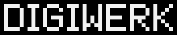
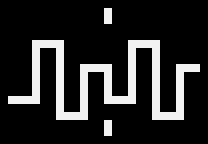
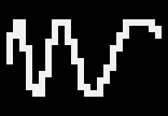
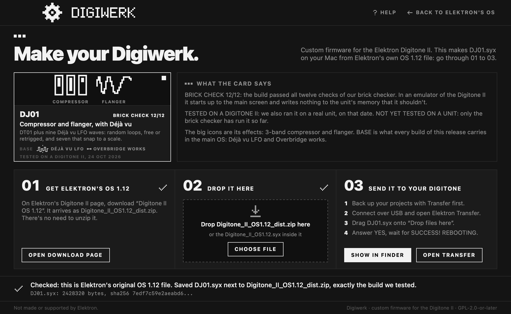

  
  &nbsp;&nbsp;
  

**Digiwerk** is custom firmware for the Elektron Digitone II, for OS 1.12. It adds a 3-band master compressor, a
flanger that reaches from a phaser-like sweep to a chorus and can follow the tempo, and LFO waves that play looping
random melodies, which can change as they repeat. You make it yourself: Digiwerk Patcher turns Elektron's own OS 1.12
file into a Digiwerk build on your Mac, and you send that build to the Digitone with Elektron Transfer. No Elektron
firmware is shared here.

Digiwerk is part of the [Modwerk](https://modwerk.app) effort, the community hub for Elektron firmware mods.

**Not made or supported by Elektron.**

**Get it:** [Digiwerk Patcher 0.1.0](https://github.com/naturarum/dn2-cfw/releases/download/v0.1.0/Digiwerk-Patcher-0.1.0.zip), for macOS 13 or
later. Then follow the [install steps](#install).

- [What's in it](#whats-in-it)
- [Install](#install)
- [Going back, and recovery](#going-back-and-recovery)
- [Safety](#safety)
- [Compatibility](#compatibility)
- [Known limitations](#known-limitations)
- [Credits](#credits) and [licence](#licence)
- For developers: [docs/DEVELOPERS.md](docs/DEVELOPERS.md)

## What's in it

Every Digiwerk build is **the base plus one pack**. The base is a set of small changes to the main OS, the same in
every build. A pack is a set of effects for the sound engine (the DSP). Effects take DSP memory, so each build carries
one pack, and you choose it in the patcher.

### The base, in every build

| | | |
|---|---|---|
|  | **DJVU** Déjà vu LFO | Nine new LFO waves after RAND. **DV-F** is a loop of random values. **DV-T** is the same loop, started again from its first value by every trig with LFO.T on. **PMAJ PMIN HIRA WTON DORI LYDI OCTA** play the DV-F loop, and when DEST is the machine's tuning they snap it to a scale: major and minor pentatonic, hirajoshi, whole-tone, dorian, lydian, octatonic. On these waves **MODE** (G) sets the loop's length (FREE 2, TRIG 4, HOLD 8, ONE 16, HALF 32 values) and **SPH** (F) how much it changes: 0 gives a new value at every step, 64 repeats the loop exactly, above 64 values swap places, and 127 swaps at every step. SPD, MULT, FADE and DEP work as always.  **Credit:** this is **Kári Garðarsson's Déjà vu LFO** from the Digitakt II ([digitakt-ii-research](https://github.com/karigardarsson/digitakt-ii-research)), brought to the Digitone II. The waves, their names and how they behave are Kári's design; Digiwerk's code is written anew for the Digitone II's LFOs. Kári's DV-F and DV-T follow the original Déjà vu LFO, **Bezronczek's** on the Syntakt ([Syntakt Firmware Workbench](https://github.com/Bezronczek/syntakt-firmware-workbench)). |

### Pack: Compressor + Flanger

The build **DJ01**. Played on a Digitone II on 24 Oct 2026.

| | | |
|---|---|---|
|  | **CMP3** 3-band master compressor | Elektron's master compressor, split into three bands at two crossovers. Each band follows the stock compressor's design (its detector, curve, attack and release, makeup). The MIXER has a page per band, **Compressor Low, Mid and High**: A **THR**, B **ATK**, C **REL**, D **MUP**, E **RAT** (1.00 turns the band off, then the stock ratios 1.50 to 20.00), F the crossover (**Low/Mid** 30 Hz to 1 kHz on the LOW page, **Mid/High** 1 to 16 kHz on the MID page), G **SCS**, the sidechain source shared by the bands, and H the band's own **MIX** (dry/wet). Each page has a meter for its band's gain reduction. The knobs use the stock compressor's pictures (the crossovers a plain dial). The settings are saved with the kit. A new kit starts with every MIX at 0, so you hear no compression until you raise one. |
|  | **FLNG** flanger | In the chorus slot, on the Flanger page. A **DPTH** sweep depth, B **SPD** sweep speed, C **TIME** the delay the sweep moves around, D **WDTH** the angle between the left and right sweeps (0 to 180 degrees). TIME sets the character: near 0 a subtle, phaser-like sweep, around 32 the classic flanger (a new kit's default), and from 64 up the feedback fades out and the sweep narrows until, by 100 to 127, FLNG is a chorus. For a flanger, keep TIME in the lower half. **FUNC + turn on SPD** steps through speeds in time with the tempo, from one sweep in 16 bars (16/1) to 1/32, as FUNC + turn does on the delay's TIME. Turning SPD without FUNC gives a free speed again. |

The delay and the reverb are Elektron's own.

Starting points for the flanger

| sound | DPTH | SPD | TIME | WDTH |
|---|---:|---:|---:|---:|
| phaser-like | 45 | 50 | 8 | 64 |
| jet | 100 | 30 | 20 | 48 |
| flanger | 96 | 30 | 32 | 48 |
| long flanger | 70 | 40 | 56 | 90 |
| flange-chorus | 60 | 60 | 82 | 100 |
| chorus | 50 | 70 | 110 | 127 |
| wide chorus | 100 | 80 | 127 | 127 |

### Later

A spring reverb (SPNG) and a tape echo (TAPE) are in the works, each for a pack of its own.

## Install

You need a Digitone II, a Mac with macOS 13 or later (Apple silicon or Intel), a USB cable and
[Elektron Transfer](https://www.elektron.se/support-downloads/transfer).

1. **Back up** your projects and the +Drive with Elektron Transfer.
2. **Download Digiwerk Patcher:** [Digiwerk-Patcher-0.1.0.zip](https://github.com/naturarum/dn2-cfw/releases/download/v0.1.0/Digiwerk-Patcher-0.1.0.zip).
   It's also on the [release page](https://github.com/naturarum/dn2-cfw/releases/latest), where `digiwerk-patch-0.1.0.zip` is the
   Terminal version and the "Source code" files aren't the app. Double-click the .zip and open **Digiwerk Patcher**.
   Apple has checked it (it's notarized). The first time, macOS asks whether to open an app from the internet: click
   **Open**.
3. **Get Elektron's OS 1.12.** On [Elektron's download page](https://elektron.se/support-downloads/digitone-ii)
   (the patcher's **OPEN DOWNLOAD PAGE** button opens it), download **Digitone II OS 1.12**. It arrives as
   `Digitone_II_OS1.12_dist.zip`. You don't need to unzip it. **Keep this .zip:** Elektron's page lists only the
   current OS, and you need this file to go back or to make another build.
4. **Drop the file** on the patcher's window, in box **02** (or click **CHOOSE FILE**). The patcher checks that it's
   Elektron's original file, makes the build and saves it next to the .zip: `DJ01.syx`. The line at the bottom says
   **Checked: this is Elektron's original OS 1.12 file.**
5. **Send it to the Digitone.** Connect it over USB and open Transfer (the patcher's **OPEN TRANSFER** button does
   it). Drag `DJ01.syx` onto **Drop files here** (**SHOW IN FINDER** shows you the file), answer **YES** on the
   Digitone and wait for **SUCCESS! REBOOTING**. The power-on screen shows **DJ01** at the top right.

Keep the volume down the first time a new build plays.

If you'd rather use Terminal, [digiwerk-patch-0.1.0.zip](https://github.com/naturarum/dn2-cfw/releases/download/v0.1.0/digiwerk-patch-0.1.0.zip) does the same. The
full guide, with what every message means: [tools/patcher/README.md](tools/patcher/README.md).

## Going back, and recovery

- **Back to Elektron's OS:** send Elektron's `Digitone_II_OS1.12.syx` (it's inside the .zip) with Transfer, the same
  way.
- **If the Digitone doesn't start:** hold **FUNC** while you switch it on. The STARTUP menu appears. Press **TRIG 4**
  (OS UPGRADE). In Transfer, use **LEGACY OS UPGRADE mode** and send Elektron's `Digitone_II_OS1.12.syx` over a
  **DIN MIDI** cable (you need a MIDI interface with a DIN out). USB doesn't work in the STARTUP menu. It takes about
  13 minutes. We tested this on our own unit.
- The STARTUP menu lives in the bootstrap, a part of the Digitone that Digiwerk never changes.

## Safety

Custom firmware is at your own risk. This is what we do to keep that risk low:

- **A brick checker with 12 checks.** Every build must pass all twelve before it goes into the patcher. Among other
  things: only the main OS and the DSP program differ from Elektron's file, and everything else, including the
  bootstrap that holds the STARTUP menu, is Elektron's, byte for byte; the Digitone's own code accepts the build's
  seal and unpacks exactly the intended OS; the build starts up to the main screen in an emulator without writing to
  the flash; the STARTUP menu is still reachable; the DSP program runs in a simulator without a fault; the OS's
  updater writes only where it should. The details:
  [tools/brickcheck/README.md](tools/brickcheck/README.md).
- **Played on a real Digitone II.** Every pack ran on our unit before release.
- **The patcher writes only tested builds.** It checks that your file is Elektron's original OS 1.12, by its sha256.
  It saves a build only if the result is, byte for byte, the build we tested. Otherwise it saves nothing.
- **No Elektron firmware is distributed.** The patcher holds our changes and instructions like "copy these bytes from
  your file". A check makes sure no 16-byte run from Elektron's file is in it.

## Compatibility

- **Digitone II on OS 1.12 only.** The patcher refuses any other file.
- **Projects and kits** stay in Elektron's format. Digiwerk's settings live in the kit's existing values and in
  spare bytes the stock OS doesn't use.
- **A kit saved on Digiwerk, opened on Elektron's OS 1.12:**
  - Déjà vu waves play as RAND and show "ERR". The value stays in the kit, so back on Digiwerk the wave comes back.
  - The stock OS ignores the compressor's band settings and plays Elektron's one-band compressor with the kit's hidden
    stock compressor settings, which Digiwerk leaves as they were. A project save on the stock OS keeps the band
    settings. A Save Kit, a +Drive library save or an export on the stock OS drops them, and back on Digiwerk that
    kit opens as an older kit does (below).
  - The stock OS plays Elektron's chorus with the flanger's four values: TIME is the chorus's HPF again.
- **A kit from Elektron's OS, opened on Digiwerk:**
  - The compressor opens as one full-band compressor with the kit's old settings (crossovers at 30 Hz and 16 kHz). In
    our tests that sounds within about a dB of the stock compressor.
  - The chorus values drive the flanger. HPF at its default 0 becomes TIME 0, the shortest, phaser-like end: set TIME
    to 32 for the classic flanger. WDTH 127, the default, sweeps the two sides 180 degrees apart.
- **Overbridge** connects as with OS 1.12. **Transfer** works as usual: every build was sent to our unit with it.
- **MIDI:** CC 106 (LFO 1 WAVE) values 7 to 15 pick the new waves, and 16 and up give OCTA (on stock they give RAND).
- **dn2_firmware_explore's lfowaves mod** (OS 1.11) uses the same WAVE values for other waves, so a project made with
  one doesn't carry over to the other.

## Known limitations

- **The Overbridge plugin knows only Elektron's names and ranges.** It offers LFO WAVE only up to RAND (don't
  automate WAVE from the plugin on a track that uses a new wave). It most likely calls the flanger's TIME "HPF" and
  shows a synced flanger speed as a plain number. The compressor's band knobs haven't been tried with the plugin.
- **Flanger:** in sync, the sweep follows the tempo but doesn't restart at the bar. The picture above TIME is still
  the stock HPF curve.
- **Déjà vu:** the loops aren't saved. WAVE, MODE and SPH are, and p-locks on WAVE work, but each power-on makes a new
  melody. On FM TONE's PITCH and WAVETONE's MAST, the scale snapping assumes semitones; that isn't checked on a unit
  yet.
- **Compressor:** the band knobs can't be p-locked (the stock compressor's can't either) and have no MIDI CC. The
  stock compressor's CCs for THR, ATK, REL, MUP, RAT and MIX (111 to 115, 118) now change only its hidden settings.
  The meters show the band's gain reduction before its MIX and makeup.
- **One pack per build.** The patcher runs on macOS only for now.

## Credits

Digiwerk builds on other people's work: [elekloader](https://github.com/irpina/elekloader) (irpina),
[digikit](https://github.com/m-dwyer/digikit) (Em D, now ElekLabs), [selache](https://github.com/js216/selache)
(Jakob Kastelic), [elektron-firmware-tool](https://github.com/mischa85/elektron-firmware-tool) (Marcel Bierling),
[octabam](https://github.com/sambanks/octabam) (Sam Banks), and the findings of
[dn2_firmware_explore](https://github.com/angellinares/dn2_firmware_explore) (angellinares). The Déjà vu LFO follows
Kári Garðarsson's design for the Digitakt II, after Bezronczek's Syntakt Firmware Workbench and the déjà vu of Émilie
Gillet's Marbles. Everyone, with licences and what we use: [CREDITS.md](CREDITS.md). Code adapted from other projects
is listed in [NOTICE](NOTICE).

Digiwerk is made by naturarum with Claude, Anthropic's AI model, in Claude Code. How we work:
[docs/DEVELOPERS.md](docs/DEVELOPERS.md#how-this-is-made).

## Licence

GPL-2.0-or-later, Copyright (C) 2026 naturarum and contributors. See [LICENSE](LICENSE) and [NOTICE](NOTICE).

Elektron and Digitone are trademarks of Elektron Music Machines. Digiwerk is not made or supported by Elektron, and
not affiliated with or endorsed by it.
