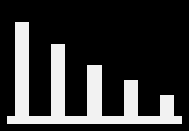
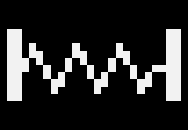

  
  &nbsp;&nbsp;
  

**Digiwerk** is custom firmware for the Elektron Digitone II, for OS 1.12. It adds a 3-band master compressor, a
flanger that reaches from a phaser-like sweep to a chorus, a tape echo with three heads, a spring reverb, LFO waves
that play looping random melodies (one of them in the track's key), three arpeggiator modes, among them a Turing
Machine loop, and the arpeggiator on MIDI tracks. You make it yourself: Digiwerk Patcher turns Elektron's own OS 1.12
file into a Digiwerk build on your Mac, and you send that build to the Digitone with Elektron Transfer. No Elektron
firmware is shared here.

Digiwerk is part of the [Modwerk](https://modwerk.app) effort, the community hub for Elektron firmware mods.

**Not made or supported by Elektron.**

**Get it:** [Digiwerk Patcher 0.2.0](https://github.com/naturarum/dn2-cfw/releases/download/v0.2.0/Digiwerk-Patcher-0.2.0.zip), for macOS 13 or
later. Then follow the [install steps](#install).

- [What's in it](#whats-in-it)
- [Install](#install)
- [Going back, and recovery](#going-back-and-recovery)
- [Safety](#safety)
- [Compatibility](#compatibility)
- [Known limitations](#known-limitations)
- [Credits](#credits) and [licence](#licence)
- For developers: [docs/DEVELOPERS.md](docs/DEVELOPERS.md)

## What's in it

Every Digiwerk build is **the base plus the effects you pick**. The base is a set of changes to the main OS, the same
in every build. The effects run in the sound engine (the DSP), one per FX slot: in each of the four slots, compressor,
chorus, delay and reverb, you keep Elektron's effect or take ours. Effects take DSP memory, so not every combination
fits: of the sixteen, fourteen are built, and you pick one in the patcher.

### The base, in every build

| | | |
|---|---|---|
|  | **DJVU** Déjà vu LFO | Nine new LFO waves after RAND. **DV-F** is a loop of random values. **DV-T** is the same loop, started again from its first value by every trig with LFO.T on. **PMAJ PMIN HIRA WTON DORI LYDI OCTA** play the DV-F loop, and when DEST is the machine's tuning they snap it to a scale: major and minor pentatonic, hirajoshi, whole-tone, dorian, lydian, octatonic. On these waves **MODE** (G) sets the loop's length (FREE 2, TRIG 4, HOLD 8, ONE 16, HALF 32 values) and **SPH** (F) how much it changes: 0 gives a new value at every step, 64 repeats the loop exactly, above 64 values swap places, and 127 swaps at every step. SPD, MULT, FADE and DEP work as always.  **Credit:** this is **Kári Garðarsson's Déjà vu LFO** from the Digitakt II ([digitakt-ii-research](https://github.com/karigardarsson/digitakt-ii-research)), brought to the Digitone II. The waves, their names and how they behave are Kári's design; Digiwerk's code is written anew for the Digitone II's LFOs. Kári's DV-F and DV-T follow the original Déjà vu LFO, **Bezronczek's** on the Syntakt ([Syntakt Firmware Workbench](https://github.com/Bezronczek/syntakt-firmware-workbench)). |

- **KEY, the LFO in the track's key.** A Déjà vu wave in the track's own key: the DV-F loop, snapped to the scale and
  root of the track's KEYBOARD SETUP. Whatever note the trig plays, the note you hear stays in the key, over the whole
  range of DEP. It's on an LFO's WAVE, past OCTA, with DEST on the machine's tuning (TUNE, TUN1, TUN2, MAST or PITCH);
  MODE and SPH work as on the other Déjà vu waves, and DEP sets how far the melody reaches.
- **LFO ONE and HALF.** An LFO in MODE ONE runs one whole cycle from where SPH starts it, then holds where it ended;
  HALF runs half a cycle. Elektron's OS 1.12 cuts them short. On synth and MIDI tracks.
- **Arp SHUF, RAND and TM.** Three more arpeggiator modes after CYCL. **SHUF** plays every held note, in every octave
  of RANGE, once per cycle, in a new order each time. **RAND** plays a random one at each step. **TM** is a Turing
  Machine loop: hold one note and the arp plays a melody from it, one note per step of ARP LENGTH (1 to 16), from the
  notes of the track's scale (KEYBOARD SETUP) over the octaves of RANGE. **LOOP CHANGE** (E) sets how often a step
  takes a new note when the loop comes round to it: 0 locks the melody, 100 changes every step every time. In TM the
  step graph shows the loop's notes.
- **The arp on MIDI tracks.** The ARP key and menu work on MIDI-machine tracks. A MIDI track whose arp is on plays its
  trigs and the keys you play through the arp, out on the track's MIDI channel; SHUF, RAND and TM work there too.
- **The Digiwerk intro.** At power-on, after Elektron's logo screen, the start-up animation shows DIGI over WERK.

### The effects

| | | |
|---|---|---|
|  | **CMP3** 3-band master compressor | Elektron's master compressor, split into three bands at two crossovers. Each band follows the stock compressor's design (its detector, curve, attack and release, makeup). The MIXER has a page per band, **Compressor Low, Mid and High**: A **THR**, B **ATK**, C **REL**, D **MUP**, E **RAT** (1.00 turns the band off, then the stock ratios 1.50 to 20.00), F the crossover (**Low/Mid** 30 Hz to 1 kHz on the LOW page, **Mid/High** 1 to 16 kHz on the MID page), G **SCS**, the sidechain source shared by the bands, and H the band's own **MIX** (dry/wet). Each page has a meter for its band's gain reduction. The knobs use the stock compressor's pictures (the crossovers a plain dial). The settings are saved with the kit. A new kit starts with every MIX at 0, so you hear no compression until you raise one. |
|  | **FLNG** flanger | In the chorus slot, on the Flanger page. A **DPTH** sweep depth, B **SPD** sweep speed, C **TIME** the delay the sweep moves around, D **WDTH** the angle between the left and right sweeps (0 to 180 degrees). TIME sets the character: near 0 a subtle, phaser-like sweep, around 32 the classic flanger (a new kit's default), and from 64 up the feedback fades out and the sweep narrows until, by 100 to 127, FLNG is a chorus. For a flanger, keep TIME in the lower half. **FUNC + turn on SPD** steps through speeds in time with the tempo, from one sweep in 16 bars (16/1) to 1/32, as FUNC + turn does on the delay's TIME. Turning SPD without FUNC gives a free speed again. |
|  | **TAPE** tape echo | In the delay slot, on the **Echo** page: one tape, three playback heads at one, two and three times head 1's time, a band filter in the feedback loop, and tape wear to dial in. A **TIME**, head 1's time on the stock delay's TIME scale, B **MODE**, the heads that play, shown under the knob as 1, 2, 3, 12, 23, 13 or 123 (23 is heads 2 and 3; the box shows the mode's number, 1 to 7), C **WID**, below 0 the repeats alternate left and right, 0 is mono, above 0 each repeat lands at a new random place, D **FDBK**, the repeats: at 64 they go on forever in every MODE, above it they grow until the tape saturates, E **CNTR**, the centre of the loop's band filter (50 Hz to 12.8 kHz), F **BW**, its width (narrow resonates, 127 is no filter), G **AGE**, tape wear: wow and flutter, hiss, soft crackle and a duller top (0 or 1 is clean), H **REV**, the send to the reverb. |
|  | **SPNG** spring reverb | In the reverb slot, on the **Spring** page: three springs that drip and boing. A **PRE** pre-delay (0 to 250 ms), B **DEC** the size, a decay of 0.3 s to 16 s, C **MODE** the springs' character (0 taut and bright, 64 the classic tank, 127 slack, deep drip, surf), D **DIRT** breaks up the tail (0 clean, heavy at 127), E **HPF** thins what goes into the tank (40 Hz to 1 kHz), F **TONE** (127 open, lower is darker), G **WDTH** (0 mono, like a real tank; up to 127, wide stereo). A new kit starts clean: PRE 0, DEC 64, MODE 64, DIRT 0, HPF 0, TONE 127, WDTH 96. |

Starting points for the flanger

| sound | DPTH | SPD | TIME | WDTH |
|---|---:|---:|---:|---:|
| phaser-like | 45 | 50 | 8 | 64 |
| jet | 100 | 30 | 20 | 48 |
| flanger | 96 | 30 | 32 | 48 |
| long flanger | 70 | 40 | 56 | 90 |
| flange-chorus | 60 | 60 | 82 | 100 |
| chorus | 50 | 70 | 110 | 127 |
| wide chorus | 100 | 80 | 127 | 127 |

### The builds

Each build is named after its four slots, in the order compressor, chorus, delay, reverb: **C**, **F**, **T** or
**S** where ours runs, **E** where Elektron's does. The name shows at the top right of the power-on screen.

| build | compressor | chorus slot | delay slot | reverb slot | played on a Digitone II |
|---|---|---|---|---|---|
| **EEEE** | Elektron's | Elektron's | Elektron's | Elektron's | not yet |
| **CEEE** | **3-band compressor** | Elektron's | Elektron's | Elektron's | not yet |
| **EFEE** | Elektron's | **flanger** | Elektron's | Elektron's | not yet |
| **EETE** | Elektron's | Elektron's | **tape echo** | Elektron's | not yet |
| **EEES** | Elektron's | Elektron's | Elektron's | **spring reverb** | not yet |
| **CFEE** | **3-band compressor** | **flanger** | Elektron's | Elektron's | 29 Oct 2026 |
| **CETE** | **3-band compressor** | Elektron's | **tape echo** | Elektron's | not yet |
| **CEES** | **3-band compressor** | Elektron's | Elektron's | **spring reverb** | not yet |
| **EFTE** | Elektron's | **flanger** | **tape echo** | Elektron's | not yet |
| **EFES** | Elektron's | **flanger** | Elektron's | **spring reverb** | not yet |
| **EETS** | Elektron's | Elektron's | **tape echo** | **spring reverb** | not yet |
| **CFTE** | **3-band compressor** | **flanger** | **tape echo** | Elektron's | 29 Oct 2026 |
| **CFES** | **3-band compressor** | **flanger** | Elektron's | **spring reverb** | not yet |
| **EFTS** | Elektron's | **flanger** | **tape echo** | **spring reverb** | not yet |

CMP3 with TAPE and SPNG doesn't fit, with or without FLNG.

## Install

You need a Digitone II, a Mac with macOS 13 or later (Apple silicon or Intel), a USB cable and
[Elektron Transfer](https://www.elektron.se/support-downloads/transfer).

1. **Back up** your projects and the +Drive with Elektron Transfer.
2. **Download Digiwerk Patcher:** [Digiwerk-Patcher-0.2.0.zip](https://github.com/naturarum/dn2-cfw/releases/download/v0.2.0/Digiwerk-Patcher-0.2.0.zip).
   It's also on the [release page](https://github.com/naturarum/dn2-cfw/releases/latest), where the "Source code" files
   aren't the app. Double-click the .zip and open **Digiwerk Patcher**.
   Apple has checked it (it's notarized). The first time, macOS asks whether to open an app from the internet: click
   **Open**.
3. **Get Elektron's OS 1.12.** On [Elektron's download page](https://elektron.se/support-downloads/digitone-ii)
   (the patcher's **OPEN DOWNLOAD PAGE** button opens it), download **Digitone II OS 1.12**. It arrives as
   `Digitone_II_OS1.12_dist.zip`. You don't need to unzip it. **Keep this .zip:** Elektron's page lists only the
   current OS, and you need this file to go back or to make another build.
4. **Pick your effects** in the patcher's four slots: in each one, Elektron's effect or ours. The patcher shows the
   build that makes and whether we've played it on a Digitone II. **MANUAL** explains every effect and base feature.
5. **Drop the file** on the patcher's window (or click **CHOOSE FILE**). The patcher checks that it's Elektron's
   original file, makes the build and saves it next to the .zip, named after its slots, for example `CFTE.syx`.
6. **Send it to the Digitone.** Connect it over USB and open Transfer. Drag the build onto **Drop files here**, answer
   **YES** on the Digitone and wait for **SUCCESS! REBOOTING**. The power-on screen shows the build's name at the top
   right.

Keep the volume down the first time a new build plays.

The full guide, with what every message means: [tools/patcher/README.md](tools/patcher/README.md).

## Going back, and recovery

- **Back to Elektron's OS:** send Elektron's `Digitone_II_OS1.12.syx` (it's inside the .zip) with Transfer, the same
  way.
- **If the Digitone doesn't start:** hold **FUNC** while you switch it on. The STARTUP menu appears. Press **TRIG 4**
  (OS UPGRADE). In Transfer, use **LEGACY OS UPGRADE mode** and send Elektron's `Digitone_II_OS1.12.syx` over a
  **DIN MIDI** cable (you need a MIDI interface with a DIN out). USB doesn't work in the STARTUP menu. It takes about
  13 minutes. We tested this on our own unit.
- The STARTUP menu lives in the bootstrap, a part of the Digitone that Digiwerk never changes.

## Safety

Custom firmware is at your own risk. This is what we do to keep that risk low:

- **A brick checker with 12 checks.** Every build must pass all twelve before it goes into the patcher. Among other
  things: only the main OS and the DSP program differ from Elektron's file, and everything else, including the
  bootstrap that holds the STARTUP menu, is Elektron's, byte for byte; the Digitone's own code accepts the build's
  seal and unpacks exactly the intended OS; the build starts up to the main screen in an emulator without writing to
  the flash; the STARTUP menu is still reachable; the DSP program runs in a simulator without a fault; the OS's
  updater writes only where it should. The details:
  [tools/brickcheck/README.md](tools/brickcheck/README.md).
- **Played on a real Digitone II, or marked.** The patcher shows, for each build, whether we played it on our unit
  and when. A build we haven't played yet has passed the brick checker, and the patcher says so.
- **The patcher writes only tested builds.** It checks that your file is Elektron's original OS 1.12, by its sha256.
  It saves a build only if the result is, byte for byte, the build we tested. Otherwise it saves nothing.
- **No Elektron firmware is distributed.** The patcher holds our changes and instructions like "copy these bytes from
  your file". A check makes sure no 16-byte run from Elektron's file is in it.

## Compatibility

- **Digitone II on OS 1.12 only.** The patcher refuses any other file.
- **Projects and kits** stay in Elektron's format. Digiwerk's settings live in the kit's existing values and in
  spare bytes the stock OS doesn't use.
- **A kit saved on Digiwerk, opened on Elektron's OS 1.12:**
  - Déjà vu waves play as RAND and show "ERR". The value stays in the kit, so back on Digiwerk the wave comes back.
  - The stock OS ignores the compressor's band settings and plays Elektron's one-band compressor with the kit's hidden
    stock compressor settings, which Digiwerk leaves as they were. A project save on the stock OS keeps the band
    settings. A Save Kit, a +Drive library save or an export on the stock OS drops them, and back on Digiwerk that
    kit opens as an older kit does (below).
  - The stock OS plays Elektron's chorus with the flanger's four values: TIME is the chorus's HPF again. The same
    goes for the tape echo and the spring: their values are the delay's and the reverb's own.
  - A track whose arp is set to SHUF, RAND or TM opens with its arp off.
- **A kit from Elektron's OS, opened on Digiwerk:**
  - The compressor opens as one full-band compressor with the kit's old settings (crossovers at 30 Hz and 16 kHz). In
    our tests that sounds within about a dB of the stock compressor.
  - The chorus values drive the flanger. HPF at its default 0 becomes TIME 0, the shortest, phaser-like end: set TIME
    to 32 for the classic flanger. WDTH 127, the default, sweeps the two sides 180 degrees apart.
  - The delay values drive the tape echo: MODE from Pingpong (1 or 2), CNTR and BW from HPF and LPF, AGE clean.
  - The reverb values drive the spring; DIRT starts at the old GAIN's value.
- **Overbridge** connects as with OS 1.12. **Transfer** works as usual.
- **MIDI:** CC 106 (LFO 1 WAVE) values 7 to 16 pick the new waves (16 is KEY), and higher values give KEY (on stock
  they give RAND).
- **dn2_firmware_explore's lfowaves mod** (OS 1.11) uses the same WAVE values for other waves, so a project made with
  one doesn't carry over to the other.

## Known limitations

- **The Overbridge plugin knows only Elektron's names and ranges.** It offers LFO WAVE only up to RAND (don't
  automate WAVE from the plugin on a track that uses a new wave). It most likely calls the flanger's TIME "HPF", gives
  the tape echo's and the spring's knobs the delay's and the reverb's names, and shows a synced flanger speed as a
  plain number. The compressor's band knobs haven't been tried with the plugin.
- **Flanger:** in sync, the sweep follows the tempo but doesn't restart at the bar. The picture above TIME is still
  the stock HPF curve.
- **Déjà vu:** the loops aren't saved. WAVE, MODE and SPH are, and p-locks on WAVE work, but each power-on makes a new
  melody. On FM TONE's PITCH and WAVETONE's MAST, the scale snapping assumes semitones; that isn't checked on a unit
  yet.
- **Compressor:** the band knobs can't be p-locked (the stock compressor's can't either) and have no MIDI CC. The
  stock compressor's CCs for THR, ATK, REL, MUP, RAT and MIX (111 to 115, 118) now change only its hidden settings.
  The meters show the band's gain reduction before its MIX and makeup.
- **Tape echo:** MODE and AGE can't be p-locked, and AGE has no MIDI CC.
- **Arp:** TM plays from the lowest note held. The shuffle order and TM's loop aren't saved: each power-on makes new
  ones. While a MIDI track's arp is on, its trigs' MIDI p-locks (CC, pitch bend, aftertouch, program change) aren't
  sent.
- **The patcher runs on macOS only** for now.

## Credits

Digiwerk builds on other people's work: [elekloader](https://github.com/irpina/elekloader) (irpina),
[digikit](https://github.com/m-dwyer/digikit) (Em D, now ElekLabs), [selache](https://github.com/js216/selache)
(Jakob Kastelic), [elektron-firmware-tool](https://github.com/mischa85/elektron-firmware-tool) (Marcel Bierling),
[octabam](https://github.com/sambanks/octabam) (Sam Banks), and the findings of
[dn2_firmware_explore](https://github.com/angellinares/dn2_firmware_explore) (angellinares). The Déjà vu LFO follows
Kári Garðarsson's design for the Digitakt II, after Bezronczek's Syntakt Firmware Workbench and the déjà vu of Émilie
Gillet's Marbles. The arpeggiator's TM takes its idea from Tom Whitwell's Turing Machine. Everyone, with licences and what we use: [CREDITS.md](CREDITS.md). Code adapted from other projects
is listed in [NOTICE](NOTICE).

Digiwerk is made by naturarum with Claude, Anthropic's AI model, in Claude Code. How we work:
[docs/DEVELOPERS.md](docs/DEVELOPERS.md#how-this-is-made).

## Licence

GPL-2.0-or-later, Copyright (C) 2026 naturarum and contributors. See [LICENSE](LICENSE) and [NOTICE](NOTICE).

Elektron and Digitone are trademarks of Elektron Music Machines. Digiwerk is not made or supported by Elektron, and
not affiliated with or endorsed by it.
