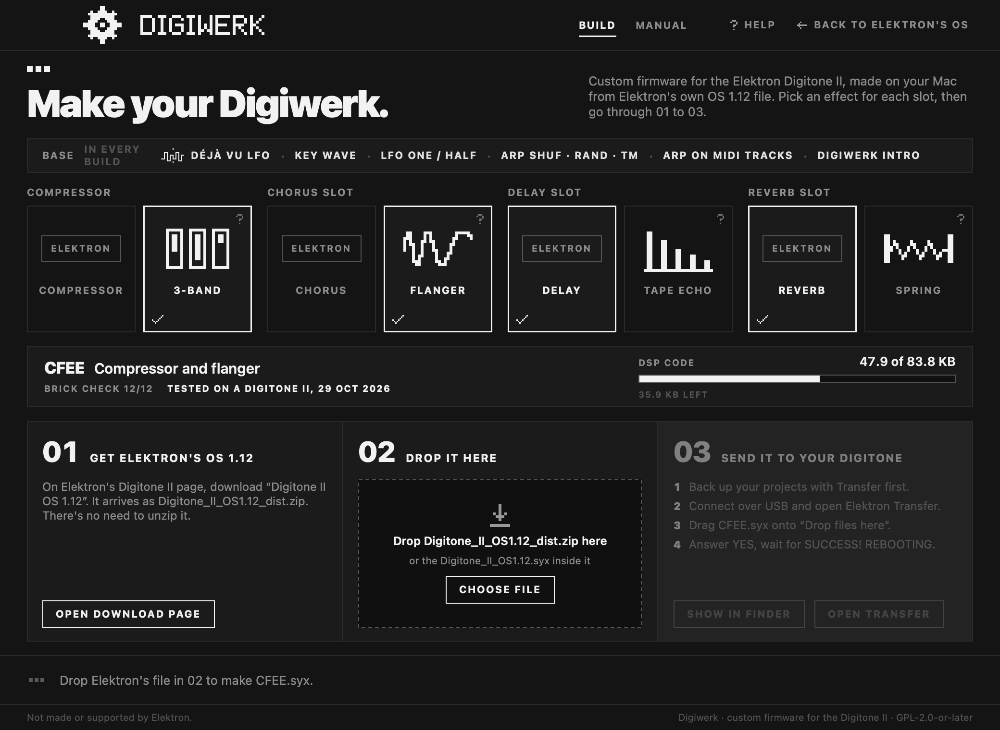
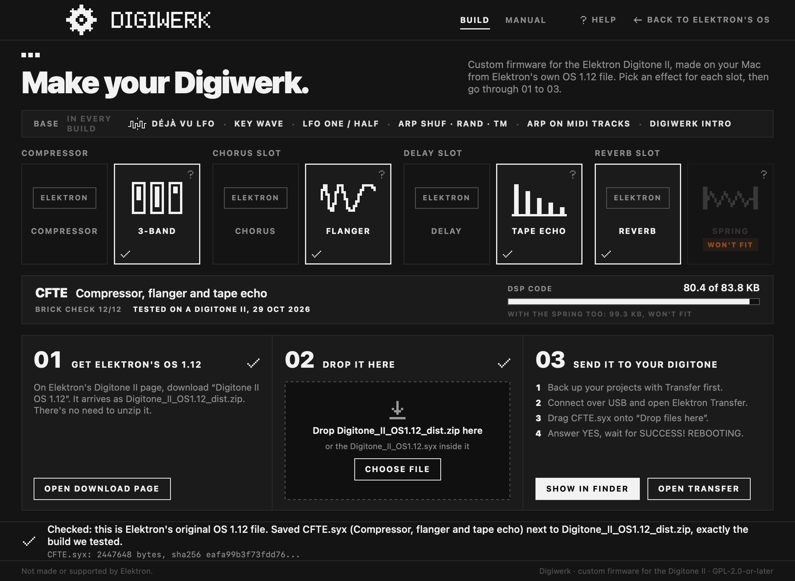

# Digiwerk Patcher

Digiwerk is custom firmware for the Elektron Digitone II. It is not made or supported by Elektron.

**Digiwerk Patcher** makes a Digiwerk OS file (like `CFTE.syx`) from Elektron's own OS 1.12 file. We are not allowed
to share Elektron's firmware, so you download it from Elektron and the patcher turns it into ours. It saves one new
file next to Elektron's file. Elektron's file stays as it was, and nothing is sent to your Digitone.

**What's in a build: the base and the effects you pick.** The *base* is the set of features in the main OS that every
build has (the BASE line at the top of the window). The effects run in the sound engine, one per FX slot: in each of
the four slots (compressor, chorus, delay, reverb) you keep Elektron's effect or take ours. Each combination is its own
build, named after its slots: C, F, T or S where ours runs, E where Elektron's does. The examples below use **CFTE**:
the 3-band compressor, the flanger and the tape echo, with Elektron's reverb.

## Step by step

Download **Digiwerk Patcher**: [Digiwerk-Patcher-0.2.0.zip](https://github.com/naturarum/dn2-cfw/releases/download/v0.2.0/Digiwerk-Patcher-0.2.0.zip)
(or the newest version from [Releases](https://github.com/naturarum/dn2-cfw/releases/latest)). Double-click the .zip and open the app.
Apple has checked the app (it's notarized), so it opens normally. The first time, macOS asks whether you want to
open an app downloaded from the internet: click **Open**.

The window has two pages, **BUILD** and **MANUAL**. BUILD shows the base, the four slots, the build your choice makes,
and the three steps side by side as 01, 02 and 03. It ticks each step when it's done. MANUAL explains every effect and
base feature; the **?** on an effect opens its page.

1. **Pick your effects.** In each slot, click Elektron's effect or ours. Under the slots, the patcher names the build
   your picks make, says how it was checked (see below) and how much of the DSP's room for our code it takes. A
   tile marked **WON'T FIT** would need more room than is left with the others picked.
2. **Get Elektron's OS 1.12.** Click **Open download page**
   (<https://elektron.se/support-downloads/digitone-ii>) and download **Digitone II OS 1.12**. It arrives in your
   Downloads folder as `Digitone_II_OS1.12_dist.zip`. You don't need to unzip it.
3. **Drop it here.** Drop `Digitone_II_OS1.12_dist.zip` onto the window, or onto the app's icon in the Dock. You can
   also click **Choose File...**. The unzipped folder, or the `Digitone_II_OS1.12.syx` inside it, works too. A second
   later the patcher says **Checked: this is Elektron's original OS 1.12 file** and saves the build next to the .zip,
   for example `CFTE.syx`. Pick other effects afterwards and it makes that build too, from the same file.

   
4. **Send it to your Digitone.**
   1. Back up your projects with Elektron Transfer first.
   2. Connect the Digitone over USB and open **Elektron Transfer** (the **Open Transfer** button does it).
   3. Drag the build, for example `CFTE.syx`, onto Transfer's **Drop files here** (**Show in Finder** shows you the
      file).
   4. Answer **YES** on the Digitone, then wait for **SUCCESS! REBOOTING**. The power-on screen shows the build's name
      at the top right.

**What "Brick check 12/12" means.** Before a build goes into the patcher, it must pass all twelve checks of our
brick checker. That's an automatic test in an emulator of the Digitone II: among other things, the build starts up
to the main screen and writes nothing to the unit's memory that it shouldn't. "Tested on a Digitone II" with a date
means we also ran it on a real unit. "Not yet tested on a unit" means only the brick checker has run it so far.

## How do I go back to Elektron's OS?

Send Elektron's `Digitone_II_OS1.12.syx` to the Digitone the same way, with Transfer. It is inside
`Digitone_II_OS1.12_dist.zip`: double-click the .zip to get it. The patcher's **Back to Elektron's OS** link (top
right) says the same.

## If your Digitone doesn't start

Hold **FUNC** while you switch the Digitone on. The STARTUP menu appears. Press **TRIG 4** (OS UPGRADE). In Transfer,
use **LEGACY OS UPGRADE mode** and send Elektron's `Digitone_II_OS1.12.syx` over a **DIN MIDI** cable (you need a MIDI
interface with a DIN out). USB doesn't work in the STARTUP menu. It takes about 13 minutes.

## What the messages mean

Under each message there's a small grey line with the exact details. If something goes wrong, copy that line into
your report.

| The patcher says | What to do |
|---|---|
| Checked: this is Elektron's original OS 1.12 file. Saved CFTE.syx next to ... | Go on with step 4. |
| ... CFTE.syx is already next to it, exactly the build we tested. | Nothing to do: it's the same file. Go on with step 4. |
| That's Digitone II OS 1.11. This needs OS 1.12 ... (or another version) | Download OS 1.12 from Elektron's page (step 2). |
| That's Elektron's OS 1.12 file, but it is damaged or incomplete. | Download it again from Elektron. |
| That's not Elektron's Digitone II OS 1.12 file. | You used another file. Use `Digitone_II_OS1.12_dist.zip` from Elektron. |
| That .zip doesn't have Digitone_II_OS1.12.syx in it. | Use the .zip from Elektron's page. |
| That's CFTE.syx already, the file this makes. | You used the patcher's result. Use Elektron's file. |
| That's EFTE, a custom OS, not Elektron's OS 1.12 file. | You used one of our builds. Use Elektron's file. |
| There is already a file called CFTE.syx in that folder. | Click **Replace** to replace it, or **Cancel** to keep it. |
| I left the existing CFTE.syx alone. | You clicked Cancel. Move or rename that file, then drop Elektron's file again. |
| I couldn't save CFTE.syx in that folder. | Copy `Digitone_II_OS1.12_dist.zip` to your Desktop and drop that copy. |
| This copy of the patcher is damaged. | Download the patcher again. |
| Something went wrong ... nothing was saved. | Please report it, with the grey line. The patcher never saves a file it can't vouch for. |

## Is any of Elektron's firmware in the patcher?

No. The patcher holds our own changes and instructions like "copy these bytes from your file". Every Elektron byte
in the result comes from your copy of Elektron's file. Before it starts, the patcher checks that your file is exactly
Elektron's original. Before it saves anything, it checks that the result is exactly the build we tested on a
Digitone II. How it works: `notes/R1.1-patcher.md`.

To check Elektron's file yourself (optional), open Terminal, type `shasum -a 256 ` with a space at the end, drag
`Digitone_II_OS1.12.syx` onto the window and press Return. It must print
`7e5b8a733d4ab1fdf7e5d22757f7d8eddaa3cbf71d0858874a791844c02ceb35`.

## For the maintainer

- A pack is one tested build. To add one, write `packs/ID.json` (or `out/ID/pack.json`), with `title`,
  `description`, `tested_on_unit` (a date like "23 Oct 2026", or "" until it ran on a unit), `effects` (the pack:
  ids from `cmp3`, `flng`, `tape`, `spng`, each with its icon in `docs/identity/`) and `base` (ids from mkpatch.py's
  `BASE`: `djvu`, `key`, `onehalf`, `arp`, `midiarp`, `intro`, `overbridge`; each but `overbridge` has its entry in
  `catalog.json`; `[]` for none). mkpatch.py refuses an unknown id. The DSP fields (`dsp`: `code_bytes`,
  `state_bytes`, `load_percent`) may be null; the 0.2.0 packs carry their code bytes. Then run the
  brick checker on `out/ID/ID.syx`. mkpatch.py refuses a pack without an ACCEPT report for exactly that file
  under `out/brickcheck/ID-*/`. It fills in the hashes and the record line (`out/patcher/ID/pack.json`).
- Build: `make PACKS="CFEE CFTE"` (the packs and `digiwerk-patch`, the Terminal tool, which does what the app does
  and lists the packs in that order; releases since 0.2.0 ship only the app), `make app
  PACKS="..."` (the app, unsigned; its packs go into `Contents/Resources/packs`), `make test`, and
  `sh app/screens.sh` (PNGs of the window, rendered offscreen). Everything lands in `out/patcher/`.
- The pixel art (the mark, the wordmark, the effect icons) is `docs/identity/*.svg`, made by its `make_icons.py`.
  `app/identity.sh` copies it into the app's `Resources/identity` at build time. The app draws each one at whole
  device pixels, without smoothing.
- The app's Help link and the startup-menu link point to this README on GitHub (`Core.guide` in
  `app/Sources/Core.swift`, marked MAINTAINER).
- Signing: set `DEVELOPMENT_TEAM` in `app/project.yml` (bundle id `com.naturarum.digiwerk-patcher`). Archive,
  export as Developer ID, then notarize and staple: the commands are in `app/build.sh`'s comments. The Terminal tool
  is notarized by submitting its zip (a bare tool can't be stapled; macOS checks it online on first run).
